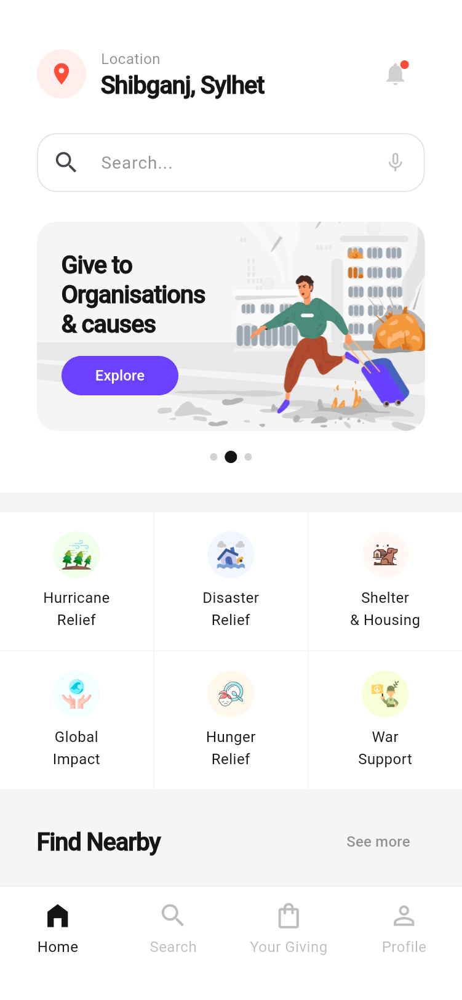
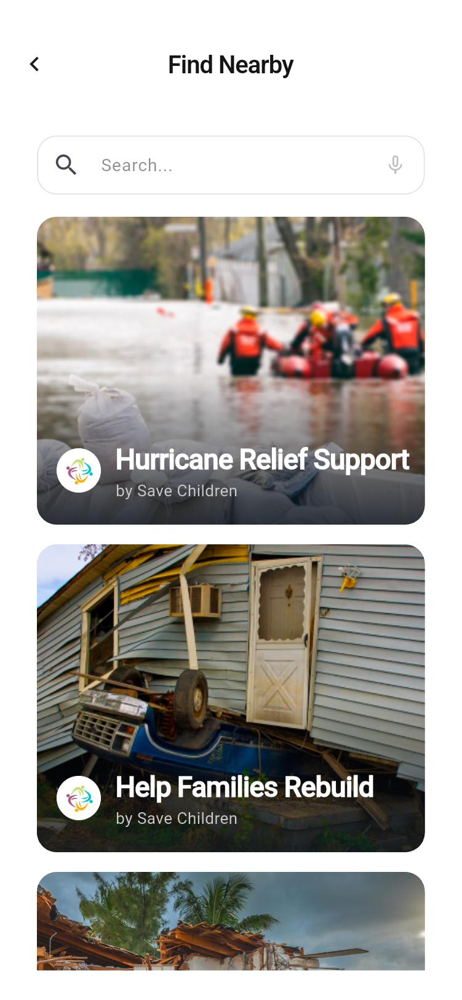
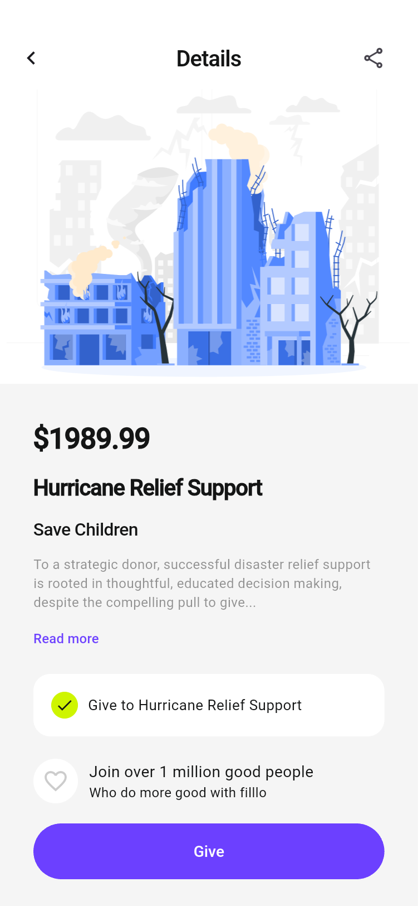
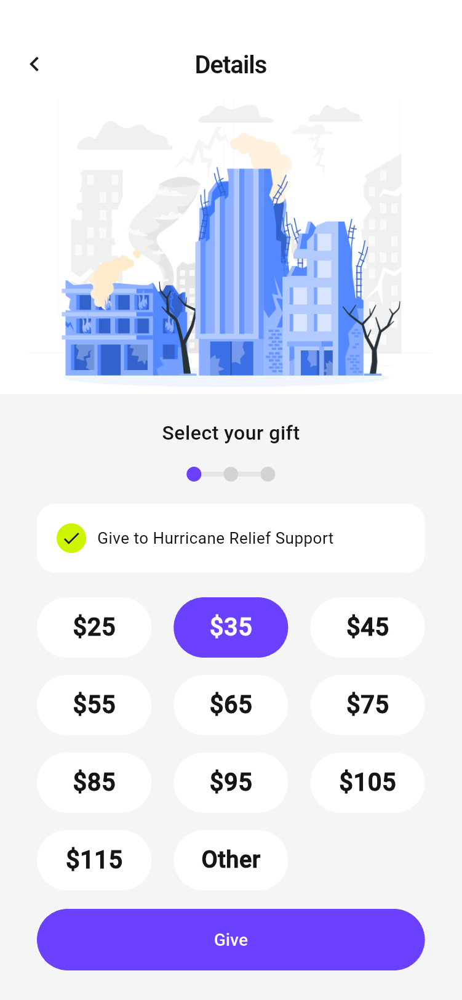
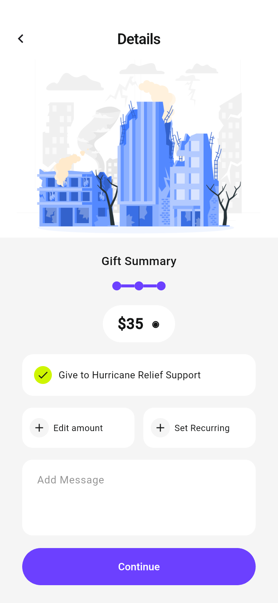
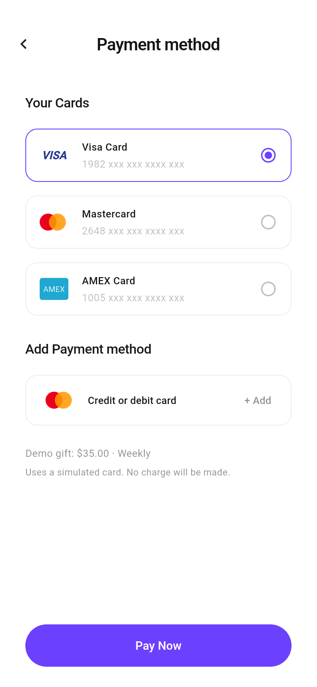
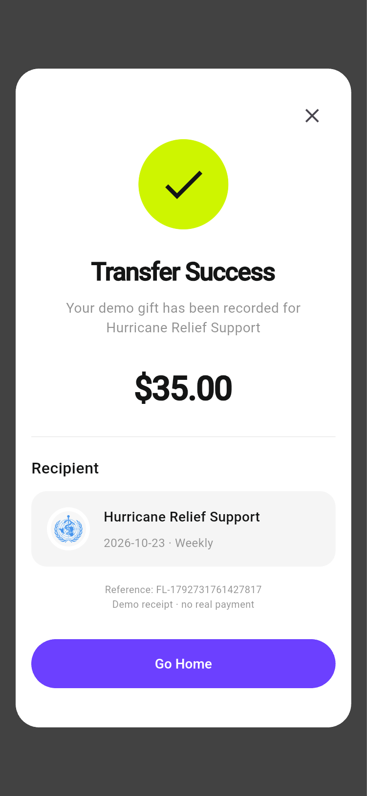
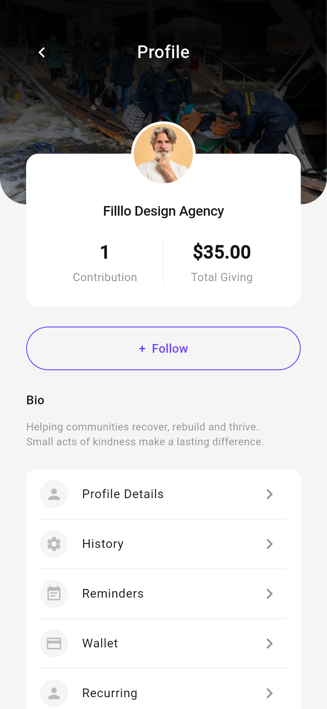

# Filllo 公益众筹 App 项目说明

## 1. 项目概览

Filllo 是一款面向公益众筹的 Flutter App，帮助用户发现救灾项目、了解公益组织并完成捐赠演示。本项目读取当前 Pixso 文件 **Filllo Crowdfunding App UI Kit** 的 **Light Version** 页面完成实现，界面保留原稿英文，说明文档使用中文。

交付包含 Flutter 源码、Android 安装包、原稿参考图、实际运行截图与自动截图脚本。项目以本地演示为范围，未接入服务器或真实支付。

### 主要页面预览

以下图片来自 Android 模拟器中的 Flutter 实际界面，原始 PNG 文件可以点击查看。

| 首页：发现公益项目 | 附近项目：照片列表 | 项目详情：了解募捐内容 |
| :---: | :---: | :---: |
|  |  |  |

| 选择捐赠金额 | 确认捐赠与周期 | 选择付款方式 |
| :---: | :---: | :---: |
|  |  |  |

| 捐赠成功收据 | 个人中心 | 捐赠记录 |
| :---: | :---: | :---: |
|  |  |  |

完整截图及页面对应关系见 [截图索引](SCREENSHOTS.md)。

## 2. 功能范围

| 模块 | 已实现行为 |
| --- | --- |
| 引导 | 三页可滑动引导、下一步、跳过、完成后记住状态 |
| 账户 | 邮箱登录、注册字段校验、密码显隐、验证码 `1234`、退出登录、游客浏览 |
| 社交入口 | Google / Apple / Facebook 按钮打开本地演示账户说明，可进入演示 |
| 发起众筹 | 选择受助人、填写标题、分类底部弹窗、本地保存草稿并预览 |
| 首页 | 可修改地点、六类公益入口、横幅、附近项目、公益组织、发起众筹入口 |
| 发现 | 分类列表、附近项目列表、组织简介、项目详情、展开介绍、复制分享文本 |
| 搜索 | 实时匹配项目标题 / 组织 / 分类、分类筛选、最近组织入口、无结果状态 |
| 捐赠 | 预设金额、自定义金额与校验、留言、周期选择、卡片选择、防重复点击 |
| 钱包 | 三张模拟卡片、添加仅含末四位的演示卡片、本机保存 |
| 收据 | 真实对应本次本地记录的金额、日期、周期、项目和唯一参考编号 |
| 个人中心 | 资料编辑、关注切换、历史记录、提醒频率、钱包、周期捐赠、帮助说明 |
| 数据恢复 | 引导 / 登录状态、资料、地点、关注、提醒、草稿、卡片末四位及捐赠记录本地持久化 |

### 使用流程

```text
首次启动 → 三页引导 → 欢迎页 → 模拟登录 / 注册 / 游客浏览
                             ↓
首页 → 分类 / 搜索 / 附近 → 项目详情 → 选择金额 → 捐赠摘要
                                                    ↓
                                   选择周期 / 添加留言 → 支付方式
                                                    ↓
                                            模拟支付 → 成功收据
                                                    ↓
                                   Your Giving / History → 查看该笔记录
```

首次使用建议：欢迎页点击 **Explore as a guest**，首页点击 **Explore**，选择项目，点击 **Give** 开始捐赠。

## 3. 设计还原

- 原稿基准宽度为 375，保留 `30` 的主要水平留白、`50` 高度的胶囊主按钮、圆角卡片和细边框输入框。
- 主色 `#6C40FF`，正文 `#141515`，浅灰背景 `#F5F5F5`，成功状态使用荧光黄绿色 `#CEF500`。
- 原稿插画、灾区照片、头像、地图、组织标识和分类图标均从 Pixso 单独导出为本地资源。页面布局由 Flutter 原生组件构建，没有把整张页面截图作为界面。
- 字体使用随项目打包的 Roboto。原稿 SF Pro Display 为平台相关字体，因此在 Android 上采用稳定可用的替代字体。
- App 使用真实系统安全区与系统状态栏，长页面可滚动，底部关键操作固定显示。320 宽屏幕会缩小引导标题。
- 修正原稿中的错位命名及明显占位内容，例如将资料页标题统一为 Profile Details，将重复的示例项目标题替换为可区分的公益项目。
- Dark Version 不在此次实现范围；地图、地点与附近列表使用固定演示数据，不请求真实定位。

原稿参考图片保存在 `docs/design/`，仅用于对照；实际运行截图保存在 `docs/screenshots/`，两者独立管理。

## 4. 项目结构

```text
FillloCrowdfunding/
├── lib/
│   ├── main.dart                    # 初始化系统样式、加载本地状态
│   ├── app.dart                     # App 入口、主题挂载、命名路由
│   ├── core/
│   │   ├── app_store.dart           # 状态容器、持久化、捐赠操作、AppScope
│   │   ├── models.dart              # Campaign / Donation 模型与示例项目
│   │   └── theme.dart               # 色彩、字体、按钮与输入框主题
│   ├── shared/
│   │   └── widgets.dart             # 页面框架、卡片、搜索框、周期弹窗等
│   └── features/
│       ├── auth/auth_pages.dart     # 引导、登录、注册、验证码、众筹草稿
│       ├── discover/discover_pages.dart # 首页、搜索、分类、附近、组织
│       ├── giving/giving_pages.dart # 详情、金额、摘要、钱包、支付、收据
│       └── profile/profile_pages.dart # 资料、历史、周期记录、帮助
├── assets/
│   ├── images/                     # Pixso 导出的单独插画与图片资源
│   └── fonts/                      # Roboto 字体和 Apache 2.0 许可
├── android/                        # Android 工程与 Filllo 图标
├── ios/                            # iOS 工程，需在 macOS 构建
├── web/                            # Flutter Web 启动文件
├── test/
│   ├── app_store_test.dart          # 记录恢复、无效金额校验
│   └── widget_test.dart             # 全路由双尺寸布局及表单阻断检查
├── integration_test/app_test.dart   # Android 捐赠端到端及全页面截图
├── test_driver/screenshots.dart     # 截图保存到本机的驱动
├── docs/
│   ├── PROJECT_GUIDE.md             # 当前说明文档
│   ├── SCREENSHOTS.md               # 截图索引
│   ├── VALIDATION.md                # 验证记录与限制
│   ├── design/                     # Pixso 原稿参考 PNG
│   └── screenshots/                # App 实际运行 PNG
├── dist/                           # 可安装 Android 演示包
├── pubspec.yaml                    # 依赖与静态资源声明
└── pubspec.lock                    # 锁定本次验证的依赖版本
```

## 5. 架构设计

采用按功能划分的轻量架构，避免为纯本地演示增加网络层、复杂路由框架或重复的状态管理依赖。

```text
页面 features/（账户 / 发现 / 捐赠 / 个人中心）
        │ 复用
        ├──────────→ shared/widgets.dart + core/theme.dart
        │ 读取 / 更新
        ↓
AppScope（InheritedNotifier）
        ↓ 通知依赖页面刷新
AppStore（ChangeNotifier）
        ├──────────→ Campaign / Donation 数据模型
        └──────────→ SharedPreferences → filllo_state JSON
```

### 状态与数据流

1. `main()` 等待 `AppStore.load()` 完成，再创建 App，避免数据恢复过程显示错误首页。
2. `FillloApp` 将 `AppStore` 放入 `AppScope`。页面通过 `AppScope.of(context)` 获取同一份状态。
3. 局部输入、选中项、密码显隐、页面索引由各自 `StatefulWidget` 管理；跨页数据与持久化数据由 `AppStore` 管理。
4. 选择项目时重置当前捐赠草稿；金额、周期和留言在摘要与支付之间传递。
5. `donate()` 校验金额后生成唯一编号与时间，创建 `Donation`，保存到本机并通知界面。
6. 历史记录通过路由参数传递具体 `Donation`，因此查看旧记录时不会误显示最后一笔收据。

### 依赖选择与代码精简

运行时仅额外使用 `shared_preferences`。状态通知、导航、表单、主题和动画使用 Flutter 内置能力。已移除计数器模板、默认测试、未使用的 Cupertino 依赖，并将重复卡片、按钮、页面框架、搜索框和周期弹窗统一复用。图片和字体随 App 打包，核心浏览与演示不依赖网络。

## 6. 路由与页面

| 路由 | 页面 |
| --- | --- |
| `/onboarding` | 三页引导 |
| `/welcome` | 欢迎与账户入口 |
| `/signin` / `/signup` / `/verify` / `/forgot` | 登录 / 注册 / 验证 / 重置说明 |
| `/fundraise-for` / `/fundraise-details` | 受助人 / 众筹草稿信息 |
| `/home` | 四个主导航：首页、搜索、Your Giving、个人中心 |
| `/search` / `/category` / `/nearby` | 搜索 / 分类项目 / 附近项目 |
| `/organization` / `/details` | 组织简介 / 项目详情 |
| `/gift` / `/custom-gift` / `/summary` | 金额选择 / 自定义金额 / 捐赠摘要 |
| `/payment` / `/receipt` | 模拟卡片支付 / 收据 |
| `/profile` / `/profile-details` | 个人中心 / 编辑资料 |
| `/wallet` / `/history` / `/recurring` / `/support` | 钱包 / 历史 / 周期记录 / 帮助 |

分类路由支持传入分类名称；收据路由支持传入一笔 `Donation`。周期、提醒、分类选择与添加卡片使用底部弹窗。

## 7. 环境与运行

本次开发环境：Windows、Flutter **3.47.7**、Dart **3.13.5**、Android 15 / API 35 模拟器。

```sh
flutter pub get
flutter devices
flutter run -d emulator-5556
```

设备编号因机器而异。Web 可用 `flutter run -d chrome`，iOS 必须在 macOS 配置 Xcode 后运行；本次未进行 iOS 运行验证。

模拟账户：任意格式有效的邮箱和至少 8 位密码。注册密码需满足四种字符类型中的至少三种；验证码为 `1234`。这里没有真实的账户注册或邮件发送。

## 8. 验证与交付

```sh
flutter analyze
flutter test
flutter drive --driver=test_driver/screenshots.dart --target=integration_test/app_test.dart -d emulator-5556
flutter build apk --release
```

自动截图流程覆盖三页引导、账户、主业务页面、空状态以及周期 / 提醒 / 分类 / 添加卡片弹窗，并执行一笔 **35 美元、每周、带留言** 的完整模拟捐赠，核对保存结果。

安装包：`dist/Filllo-1.0.0-demo.apk`。使用开发签名供本地安装体验，正式发布前需要配置自己的签名和真实服务。详细执行结果见 [验证记录](VALIDATION.md)。

## 9. 演示边界与后续接入

- 登录和验证码为本地演示，不是身份认证；不保存密码。
- 支付只生成本地记录，不与银行卡、银行或第三方支付平台连接；新增卡片只输入末四位，不收集完整卡号或安全码。
- 周期捐赠与提醒只保存频率偏好，不触发自动扣款或系统通知。
- 组织、募捐金额、地点、最近搜索入口与地图为演示内容；附近列表不进行真实地理计算。
- 众筹草稿仅保存在本机，无公开发布与后台审核流程。
- SharedPreferences 用于轻量演示数据，正式业务应迁移至服务端接口和可审计的交易存储，并增加认证、支付回调与幂等处理。
- Pixso 素材来自用户提供的参考文件，商业发布前应确认该 UI Kit 中照片、插画和标识的使用授权。
